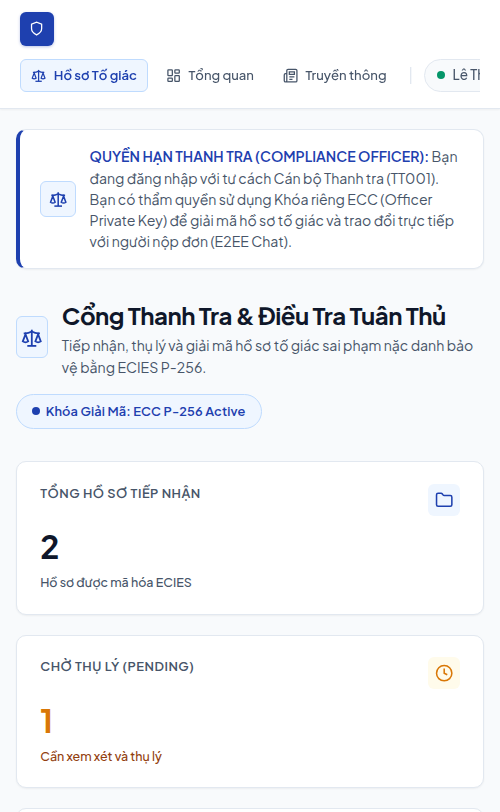
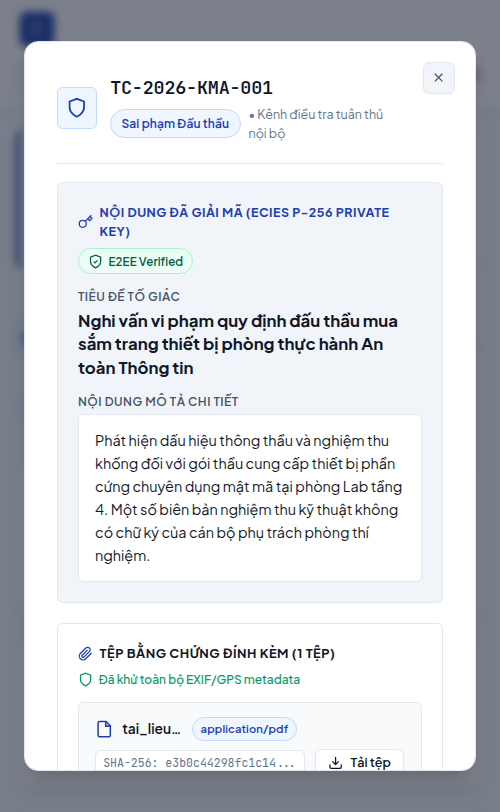
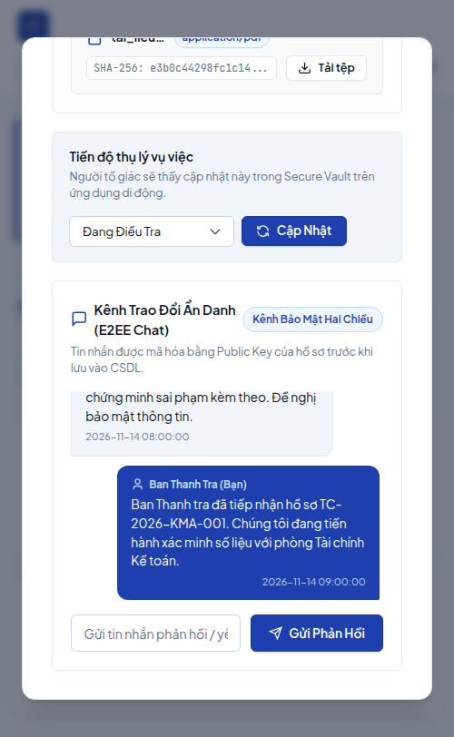
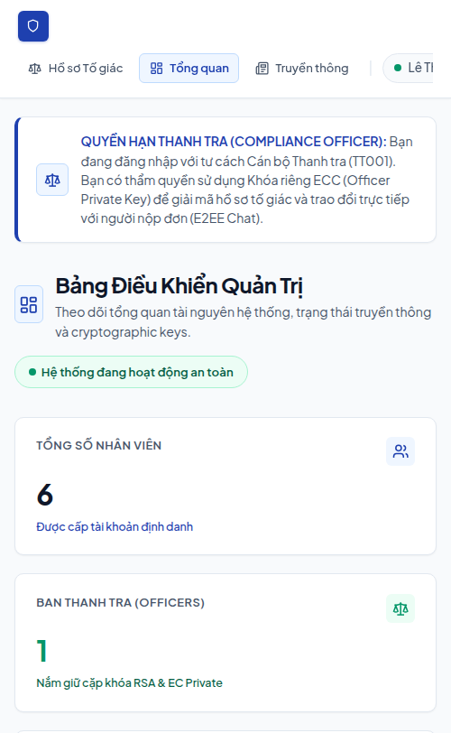
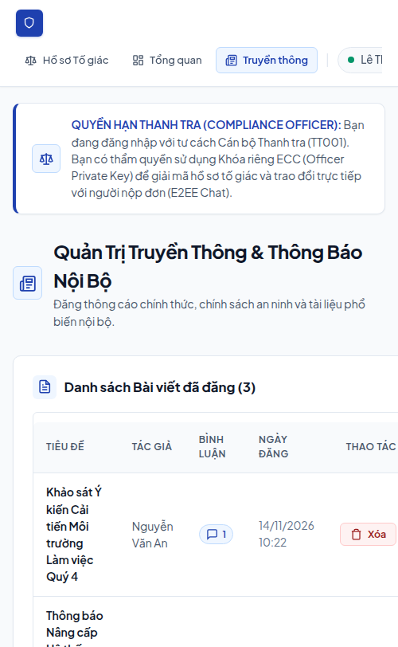
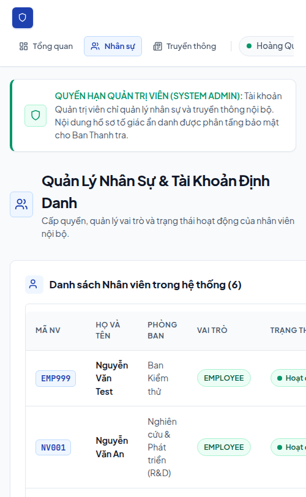
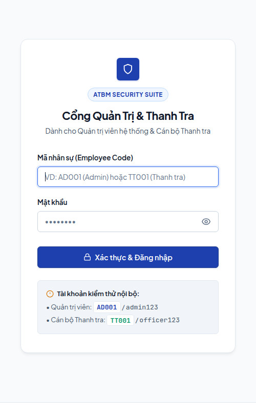
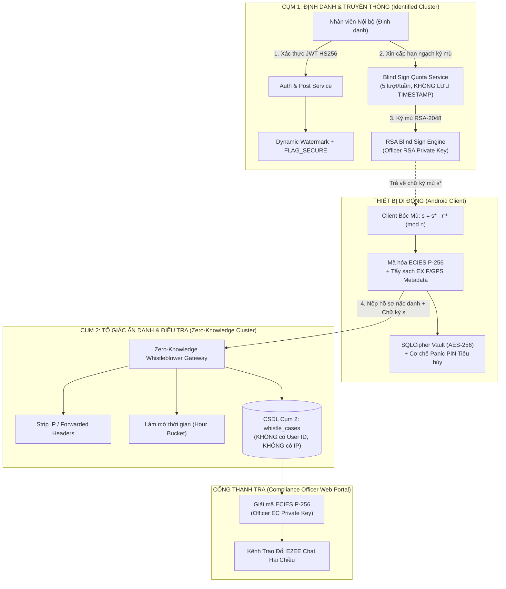

# 🛡️ ATBM Security Suite: Secure Internal Communications & Whistleblower Engine

[](https://fastapi.tiangolo.com/)
[](https://www.python.org/)
[](https://cryptography.io/)
[](https://developer.android.com/)
[](https://www.zetetic.net/sqlcipher/)
[](backend/run_security_tests.py)
[](backend/tests/)

> **Đồ án Chuyên ngành An toàn Bảo mật Hệ thống Thông tin — Học viện Kỹ thuật Mật mã (KMA)**  
> **Đề tài**: Xây dựng Hệ thống Truyền thông Nội bộ Doanh nghiệp kết hợp Cổng Tố Giác Sai Phạm Ẩn Danh (*Zero-Knowledge Whistleblower Engine*) ứng dụng **Chữ ký mù RSA Chaum (RSA-2048)**, **Mã hóa lai ECIES (ECC P-256 + HKDF-SHA256 + AES-256-GCM)**, **Kênh trao đổi E2EE hai chiều**, **Kho dữ liệu cục bộ an toàn SQLCipher Vault** và **Cơ chế Tiêu hủy Khẩn cấp Panic PIN**.

---

## 📸 Hình Ảnh Giao Diện Thực Tế (Visual Interface Showcase)

Giao diện Web Admin và Cổng Thanh tra được thiết kế theo phong cách **Modern Slate & Executive Navy** chuyên nghiệp, trang nhã, dịu mắt và tối ưu chuẩn công thái học cho cơ quan quản lý an ninh, tư pháp:

### 1. Cổng Tiếp Nhận & Thụ Lý Hồ Sơ Tố Giác Ẩn Danh (Ban Thanh Tra)
> Tiếp nhận hồ sơ sai phạm ẩn danh được mã hóa ECIES P-256, phân nhóm trạng thái (`PENDING`, `INVESTIGATING`, `RESOLVED`, `REJECTED`) và làm mờ thời gian gửi (`created_bucket`).



---

### 2. Hộp Thoại Giải Mã ECIES P-256 Bằng Khóa Riêng Của Thanh Tra Viên
> Chỉ duy nhất cán bộ Thanh tra sở hữu **Officer Private Key** mới có quyền giải mã bản rõ tiêu đề, nội dung và xác thực chữ ký E2EE Verified. Quản trị viên hệ thống (Admin) bị chặn hoàn toàn.



---

### 3. Kênh Trao Đổi E2EE Chat Hai Chiều & Bằng Chứng Đa Phương Tiện
> Cho phép Thanh tra viên và Người tố giác ẩn danh trao đổi nghiệp vụ an toàn. Bằng chứng đa phương tiện (ảnh, âm thanh, video, tài liệu) được đối soát mã băm SHA-256 và tẩy sạch siêu dữ liệu EXIF/GPS.



---

### 4. Bảng Điều Khiển Quản Trị Hệ Thống (System Admin Dashboard)
> Theo dõi tổng quan tài nguyên hệ thống, người dùng định danh, thông báo mới nhất và trạng thái kích hoạt của các cặp khóa mật mã (RSA Blind Sign Key, ECC E2EE Key).



---

### 5. Quản Trị Truyền Thông & Bảng Tin Nội Bộ
> Đăng tải chính sách bảo mật, thông cáo chính thức và tài liệu phổ biến nội bộ với tùy chọn ghim thông báo quan trọng lên đầu ứng dụng di động.



---

### 6. Quản Lý Nhân Sự & Phân Quyền Vai Trò (RBAC)
> Khởi tạo tài khoản định danh, phân quyền vai trò đa tầng (`EMPLOYEE`, `COMPLIANCE_OFFICER`, `BOARD_DIRECTOR`, `SYSTEM_ADMIN`) và tính năng khóa / mở khóa tài khoản tức thời.



---

### 7. Cổng Đăng Nhập Quản Trị An Ninh
> Form xác thực Quản trị viên & Thanh tra với tính năng kiểm tra quyền hạn, chuyển đổi ẩn/hiện mật khẩu và hỗ trợ gợi ý tài khoản kiểm thử nội bộ.



---

## 🌟 Kiến Trúc Mật Mã Cốt Lõi (Dual-Cluster Architecture)

Hệ thống được thiết kế phân tầng vật lý và logic thành **2 Cụm hoàn toàn độc lập** nhằm triệt tiêu mọi khả năng liên kết danh tính (*Unlinkability*):



### Các Nguyên Lý Bảo Mật Trọng Yếu:
1. **Không thể liên kết (Unlinkability qua RSA Blind Signature):**
   - Server ký xác thực lên thông điệp đã bị làm mù bởi hệ số ngẫu nhiên $r$: $m^* = m \cdot r^e \pmod n$.
   - Server xác nhận người nộp là nhân viên hợp lệ nhưng **toàn bộ quá trình không thể biết nội dung $m$ là gì**, không thể liên kết giữa tài khoản xin hạn ngạch ở Cụm 1 và hồ sơ gửi lên ở Cụm 2.
2. **Triệt tiêu Tấn công Tương quan Thời gian (Timing Correlation Attack):**
   - Bảng hạn ngạch `blind_sign_quotas` **tuyệt đối không lưu cột timestamp**.
   - Thời gian gửi hồ sơ `created_bucket` được làm tròn chuẩn xác về đầu giờ chẵn (`minute=0, second=0`).
3. **Mã hóa Lai ECIES P-256 (Elliptic Curve Integrated Encryption Scheme):**
   - Tiêu đề và mô tả hồ sơ được mã hóa bằng khóa công khai ECC SECP256R1 của Ban Thanh tra kết hợp hàm dẫn xuất khóa HKDF-SHA256 và thuật toán mã hóa khối xác thực AES-256-GCM.
   - Ngay cả System Admin hay Database Administrator cũng không thể giải mã được hồ sơ.
4. **Tẩy Sạch Siêu Dữ Liệu Tự Động (Metadata Sanitizer):**
   - Mọi tệp ảnh bằng chứng được xử lý tái tạo pixel thô trên cả Client và Server nhằm loại bỏ 100% tọa độ GPS, nhãn hiệu thiết bị và thông số camera.
5. **Kho Dữ Liệu An Toàn SQLCipher & Panic PIN Tiêu Hủy:**
   - Client lưu trữ mã token vụ việc và khóa riêng trong CSDL cục bộ mã hóa bằng SQLCipher (AES-256).
   - Khi bị ép buộc mở ứng dụng, nhập **Panic PIN (999999)** sẽ kích hoạt cơ chế ghi đè xóa sạch (*Overwrite Shredding*) toàn bộ dữ liệu mật và hiển thị giao diện ngụy trang rỗng.

---

## 📂 Cấu Trúc Thư Mục Dự Án

```text
atbm/
├── README.md                          # Tổng quan dự án, kiến trúc & hướng dẫn khởi chạy
├── backend/                           # Phân hệ Máy chủ (FastAPI + SQLAlchemy + Cryptography)
│   ├── .env.example                   # Mẫu cấu hình môi trường chuẩn
│   ├── requirements.txt               # Danh mục thư viện phụ thuộc Python
│   ├── run_security_tests.py          # Bộ kiểm toán 5 kịch bản bảo mật cốt lõi KMA
│   ├── app/
│   │   ├── main.py                    # Khởi tạo FastAPI & Zero-Knowledge Middleware
│   │   ├── core/                      # Cấu hình bảo mật (`config.py`) & JWT/Hashing (`security.py`)
│   │   ├── crypto/                    # Mật mã học: `blind_signature.py`, `ecies.py`, `key_manager.py`, `sanitizer.py`
│   │   ├── db/                        # Kết nối CSDL (`session.py`) & nạp dữ liệu mẫu (`seed.py`)
│   │   ├── models/                    # ORM Models: Cụm 1 (`identified.py`) & Cụm 2 (`anonymous.py`)
│   │   ├── schemas/                   # Pydantic Schemas xác thực dữ liệu đầu vào
│   │   ├── api/                       # Điều phối: `deps.py`, `admin_web.py` (SSR) & `v1/` (REST API)
│   │   └── templates/                 # Giao diện Jinja2 Cổng Quản trị & Thanh tra (Modern Slate)
│   └── tests/                         # Hệ thống kiểm thử phân tầng
│       ├── whitebox/                  # Kiểm thử Hộp trắng (Toán học Mật mã, ORM, Session, Deps)
│       ├── blackbox/                  # Kiểm thử Hộp đen (REST API, BVA, Phân lớp tương đương, RBAC)
│       └── performance/               # Đo kiểm hiệu năng mật mã & Chịu tải đồng thời
├── android/                           # Phân hệ Máy khách Di động (Kotlin + Jetpack Compose)
│   └── app/src/
│       ├── main/kotlin/com/atbm/app/  # Mã nguồn ứng dụng di động Android
│       └── test/java/com/atbm/app/    # Kiểm thử đơn vị mật mã di động (`CryptoUnitTest.kt`)
└── docs/                              # Tài liệu Thiết kế & Kiểm thử Nghiệm thu
    ├── screenshots/                   # Thư viện ảnh chụp giao diện hệ thống thực tế
    ├── implementation_plan.md         # Kiến trúc tổng thể & Lộ trình triển khai
    ├── security-whitepaper.md         # Sách trắng Mật mã học & Phân tích mối đe dọa
    ├── api-reference.md               # Đặc tả giao thức REST API chi tiết
    ├── master_test_plan.md            # Kế hoạch nghiệm thu kiểm thử tổng thể 4 trụ cột
    ├── test_execution_report.md       # Báo cáo số liệu thực thi kiểm thử
    └── user-manual.md                 # Sách hướng dẫn vận hành cho Cán bộ & Nhân viên
```

---

## 🚀 Hướng Dẫn Cài Đặt & Khởi Chạy Nhanh

### 1. Phân Hệ Máy Chủ (Backend FastAPI)

Yêu cầu môi trường: **Python 3.11+**

```bash
# 1. Di chuyển vào thư mục backend
cd backend

# 2. Khởi tạo và kích hoạt môi trường ảo Python
python3 -m venv .venv
source .venv/bin/activate

# 3. Cài đặt các gói phụ thuộc
pip install -r requirements.txt

# 4. Nạp dữ liệu mẫu (Tài khoản mẫu, bản tin nội bộ & hồ sơ mẫu)
python -m app.db.seed

# 5. Khởi chạy máy chủ FastAPI (Port 8000)
uvicorn app.main:app --host 0.0.0.0 --port 8000 --reload
```

* **Cổng Quản trị & Thanh tra Web:** [http://localhost:8000/admin/login](http://localhost:8000/admin/login)
* **Tài liệu Swagger API Interactive:** [http://localhost:8000/docs](http://localhost:8000/docs)
* **Tài liệu Redoc API:** [http://localhost:8000/redoc](http://localhost:8000/redoc)

---

### 2. Danh Mục Tài Khoản Kiểm Thử Mặc Định

| Vai trò | Mã nhân sự | Mật khẩu | Quyền hạn & Chức năng |
| :--- | :---: | :---: | :--- |
| **Cán bộ Thanh tra (`COMPLIANCE_OFFICER`)** | `TT001` | `officer123` | Nắm giữ **Officer Private Key**, có thẩm quyền giải mã hồ sơ tố giác tại `/admin/cases`, cập nhật tiến độ và trao đổi E2EE Chat. |
| **Quản trị viên (`SYSTEM_ADMIN`)** | `AD001` | `admin123` | Quản lý nhân sự (`/admin/users`) và truyền thông (`/admin/posts`). **Bị chặn tuyệt đối quyền giải mã hồ sơ tố giác**. |
| **Ban Giám đốc (`BOARD_DIRECTOR`)** | `GD001` | `director123` | Đăng tải chính sách bảo mật và thông cáo chính thức trên bảng tin nội bộ. |
| **Nhân viên (`EMPLOYEE`)** | `NV001` / `NV002` | `employee123` | Đọc bảng tin có Watermark, xin cấp chữ ký mù và gửi hồ sơ tố giác ẩn danh từ Mobile App. |

---

### 3. Phân Hệ Ứng Dụng Di Động (Android Client)

Yêu cầu: **Android Studio Ladybug / Meerkat**, **Android SDK 34**, Thiết bị thật hoặc Máy ảo Android (`Pixel 8`, API 34).

```bash
# 1. Chuyển tiếp cổng kết nối từ máy ảo về máy tính phát triển
adb reverse tcp:8000 tcp:8000

# 2. Biên dịch và cài đặt APK Debug
cd android
./gradlew installDebug

# 3. Khởi động ứng dụng trên thiết bị
adb shell am start -n com.atbm.app/.MainActivity
```

---

## 🧪 Hệ Thống Kiểm Thử & Kiểm Toán Bảo Mật

Hệ thống duy trì quy chuẩn kiểm thử nghiêm ngặt đạt **100% tỷ lệ vượt qua**:

### 1. Suite Kiểm Toán An Ninh Mật Mã KMA (`run_security_tests.py`)
Chạy bộ kiểm toán bảo vệ 5 kịch bản an toàn cốt lõi:
```bash
cd backend && .venv/bin/python run_security_tests.py
```

| STT | Kịch bản kiểm toán an ninh | Kết quả | Mô tả kỹ thuật |
| :---: | :--- | :---: | :--- |
| **1** | **Chống Chữ Ký Mù Giả Mạo** (*Anti-Forgery Signature*) | `PASS` | Từ chối 100% hồ sơ có chữ ký sai lệch hoặc chữ ký từ khóa RSA không thuộc Ban Thanh tra (HTTP 400). |
| **2** | **Bất Biến Unlinkability & Ranh Giới Cụm 2** | `PASS` | Kiểm toán Schema CSDL Cụm 2 không chứa trường định danh; triệt tiêu hoàn toàn dấu thời gian trong hạn ngạch; làm mờ `created_bucket` theo giờ chẵn. |
| **3** | **Chống Tráo Đổi Bằng Chứng & Nội Dung** (*Anti-Tampering*) | `PASS` | Từ chối ngay lập tức khi phát hiện sai lệch dù chỉ 1 byte trong tệp bằng chứng hoặc nội dung mô tả so với mã băm đã ký mù. |
| **4** | **Tẩy Sạch Siêu Dữ Liệu Nhạy Cảm** (*Metadata Sanitizer*) | `PASS` | Tẩy sạch 100% thẻ EXIF, tọa độ GPS kinh độ/vĩ độ và thông tin thiết bị trong ảnh bằng chứng. |
| **5** | **Cơ Chế Tiêu Hủy Khẩn Cấp Panic PIN** (*Emergency Wipe*) | `PASS` | Tiêu hủy kho dữ liệu SQLCipher bằng kỹ thuật ghi đè (*Overwrite Shredding*) và chuyển về trạng thái ngụy trang rỗng khi kích hoạt mã khẩn cấp `999999`. |

---

### 2. Bộ Kiểm Thử Đơn Vị & Tích Hợp (`pytest`)
Chạy toàn bộ 52 bài kiểm thử Hộp trắng và Hộp đen:
```bash
backend/.venv/bin/pytest backend/tests/
```
* **Kết quả**: `52 passed, 0 failed` (Bao gồm kiểm thử API, ORM Models, ECIES Encryption, RSA Blind Sign Math, Phân lớp tương đương BVA, Quyền hạn RBAC, Quản trị Web SSR).

---

## 📚 Tài Liệu Kỹ Thuật Bổ Sung

* [Sách Trắng Mật Mã Học & Mô Hình An Ninh](docs/security-whitepaper.md)
* [Đặc Tả Chi Tiết Giao Thức REST API](docs/api-reference.md)
* [Kế Hoạch & Ma Trận Kiểm Thử Nghiệm Thu (Master Test Plan)](docs/master_test_plan.md)
* [Báo Cáo Số Liệu Thực Thi Kiểm Thử Chi Tiết](docs/test_execution_report.md)
* [Sổ Tay Hướng Dẫn Vận Hành Hệ Thống](docs/user-manual.md)
* [Kịch Bản Thuyết Trình Bảo Vệ Đồ Án](docs/demo-defense-guide.md)

---

## 👥 Đơn Vị Thực Hiện & Bản Quyền

* **Học viện Kỹ thuật Mật mã (KMA)** — Khoa An toàn Thông tin.
* Đồ án môn học: **An toàn Bảo mật Hệ thống Thông tin**.
* Giấy phép sử dụng: Nghiên cứu học thuật và Đào tạo an ninh thông tin.
