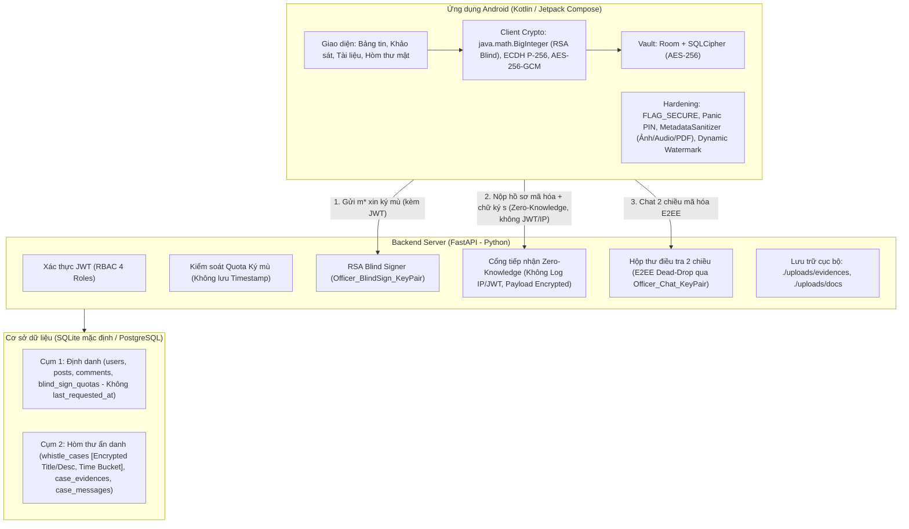

# Kế Hoạch Triển Khai Hệ Thống Secure Internal Comms & Whistleblower Engine (Đã Tối Ưu Mật Mã & Chống Rò Rỉ)

Hệ thống truyền thông nội bộ doanh nghiệp kết hợp cổng tố giác sai phạm ẩn danh (Whistleblowing) với bảo đảm toán học về tính Không thể liên kết (**Unlinkability**), Mã hóa đầu-cuối (**E2EE**), và Bảo vệ toàn vẹn bằng chứng (**Evidence Integrity**).

---

## 1. TỔNG QUAN KIẾN TRÚC HỆ THỐNG



---

## 2. NGUYÊN LÝ MẬT MÃ HỌC CỐT LÕI (CẢI TIẾN)

### 2.1. Phân tách Cặp Khóa Ban Thanh tra (Key Separation Principle)
Ban Thanh tra quản lý **2 cặp khóa độc lập hoàn toàn** nhằm đảm bảo nguyên tắc phân tách trách nhiệm mật mã:
1. **Officer_BlindSign_KeyPair (RSA-2048):**
   - Khóa công khai: $pk_{blind} = (e, N)$ (công bố rộng rãi cho toàn bộ nhân viên).
   - Khóa bí mật: $sk_{blind} = d$ (chỉ lưu trên máy chủ an toàn của Ban Thanh tra).
   - Mục đích: **Chỉ dùng duy nhất cho việc cấp phát chữ ký mù xác thực tư cách nhân viên**.
2. **Officer_Chat_KeyPair (ECC Curve P-256 / secp256r1):**
   - Khóa công khai: $pk_{officer\_chat}$ (công bố công khai).
   - Khóa bí mật: $sk_{officer\_chat}$ (chỉ Ban Thanh tra nắm giữ).
   - Mục đích: **Dùng cho mã hóa hồ sơ tố cáo (Title/Description/Evidence) và trao đổi khóa phiên E2EE trong Hộp thư điều tra 2 chiều**.

---

### 2.2. Cơ chế Chữ ký mù RSA & Ràng buộc Toàn vẹn Bằng chứng (Evidence Integrity Binding)

1. **Chuẩn bị hồ sơ & Mã hóa bảo vệ trước Admin/DBA:**
   - App sinh ngẫu nhiên `Case_Token` (UUIDv4) và cặp khóa tạm `Case_KeyPair` $(pk_{case}, sk_{case})$ qua chuẩn đường cong elliptic P-256.
   - App làm sạch siêu dữ liệu toàn bộ tệp đính kèm qua `MetadataSanitizer` (Ảnh, Audio, PDF).
   - **Mã hóa toàn bộ file bằng chứng:** App sinh một khóa đối xứng ngẫu nhiên `File_Key` (AES-256-GCM) để mã hóa từng file bằng chứng trước khi upload lên Server. `File_Key` được đính kèm bên trong nội dung `Description` trước khi mã hóa ECIES, do đó chỉ có Ban Thanh tra (giữ $sk_{officer\_chat}$) mới giải mã EncDesc ra được `File_Key` để mở file. Thư mục `./uploads/evidences` trên Server chỉ chứa blob mã hóa — **Admin hệ thống mở ra cũng không xem được**.
   - App tính mã băm SHA-256 cho từng file **đã mã hóa**: $h_{file\_1} = \text{SHA256}(\text{EncFile}_1), \dots, h_{file\_k} = \text{SHA256}(\text{EncFile}_k)$.
   - App mã hóa `Title` và `Description` (bao gồm cả `File_Key`) bằng $pk_{officer\_chat}$ qua chuẩn ECIES (AES-256-GCM) $\to (\text{EncTitle}, \text{EncDesc})$. Theo chuẩn `AES/GCM/NoPadding` của Android JCA, 16 bytes GCM Auth Tag được nối thẳng vào đuôi mảng byte Ciphertext.
   - **Công thức tính mã băm ràng buộc toàn vẹn $H$:**
     $$H = \text{SHA256}\left(\text{Category} \parallel \text{EncTitle} \parallel \text{EncDesc} \parallel \text{Case\_Token} \parallel pk_{case} \parallel h_{file\_1} \parallel \dots \parallel h_{file\_k}\right) \pmod N$$
     *(Đảm bảo: Kẻ tấn công hoặc Admin không thể tráo đổi văn bản hay thay thế bất kỳ file bằng chứng nào trên đường truyền/ổ cứng mà chữ ký vẫn hợp lệ. Đồng thời, các file trên ổ cứng Server đều ở dạng mã hóa, Admin mở trực tiếp cũng không xem được).*

2. **Làm mù (Blinding):**
   - App sinh số ngẫu nhiên bí mật $r \in \mathbb{Z}_N^*$ (nguyên tố cùng nhau với $N$, $\gcd(r, N) = 1$).
   - App tính giá trị làm mù:
     $$m^* = (H \cdot r^e) \bmod N$$
   - App gửi $m^*$ lên API `POST /api/v1/compliance/blind-sign` kèm theo JWT xác thực nhân viên.

3. **Cấp phát chữ ký mù (Blind Signing):**
   - Server kiểm tra: Tài khoản nhân viên hợp lệ + Chưa vượt Quota tuần ($K$ lượt, mặc định $K=5$, đặt rộng rãi để chống lạm dụng Quota khi Client bị rớt mạng chưa nhận được $s^*$ và phải gửi lại).
   - Server ký mù:
     $$s^* = (m^*)^d = (H \cdot r^e)^d \equiv H^d \cdot r^{e \cdot d} \equiv H^d \cdot r \pmod N$$
   - Server tăng `request_count` trong bảng `blind_sign_quotas` (tuyệt đối không ghi nhận thời gian chi tiết) và trả lời $s^*$ cho App.
   - *Lưu ý Idempotency: Nếu điện thoại nhân viên bị rớt mạng trước khi nhận $s^*$, nhân viên có thể gửi lại $m^*$ mà chỉ mất thêm 1 lượt Quota. Với $K=5$ lượt/tuần đủ rộng cho cả trường hợp retry và demo nhiều lần trên cùng 1 tài khoản mẫu.*

4. **Bóc mù (Unblinding):**
   - App nhận $s^*$, dùng số bí mật $r$ tính nghịch đảo modulo $r^{-1} \bmod N$:
     $$s = (s^* \cdot r^{-1}) = (H^d \cdot r \cdot r^{-1}) \equiv H^d \bmod N$$
   - $s$ chính là chữ ký RSA hợp lệ của Ban Thanh tra trên toàn bộ gói hồ sơ và bằng chứng!

5. **Nộp hồ sơ Zero-Knowledge:**
   - App tạo kết nối độc lập không kèm JWT, không cookie, không gửi Device ID tới `POST /api/v1/anonymous/cases`.
   - Gói tin nộp: $\{\text{Category}, \text{EncTitle}, \text{EncDesc}, \text{Case\_Token}, pk_{case}, s, \text{EncFiles (đã mã hóa AES-256-GCM bằng File\_Key)}\}$.
   - Server tính lại mã băm SHA-256 cho từng file **đã mã hóa** nhận được, tính lại $H$, và kiểm tra tính hợp lệ toán học:
     $$s^e \bmod N \stackrel{?}{=} H$$
   - Nếu đúng, hồ sơ được lưu vào bảng `whistle_cases` với thời gian được làm tròn theo khung giờ (`time_bucket`). Các file bằng chứng mã hóa được lưu nguyên trạng vào `./uploads/evidences/` (Server không giải mã được).

---

### 2.3. Kênh Chat 2 Chiều E2EE & Chuẩn hóa Cấu trúc Gói tin (Anonymous Dead-Drop)

Sử dụng chuẩn mã hóa **ECIES (P-256 + HKDF + AES-256-GCM)**:

- **Định dạng tin nhắn mã hóa chuẩn:**
  $$\text{Payload} = \text{Ephemeral\_PubKey (65 bytes)} \parallel \text{IV (12 bytes)} \parallel \text{Ciphertext} \parallel \text{Auth\_Tag (16 bytes)}$$

- **Luồng Ban Thanh tra $\to$ Người tố cáo:**
  1. Ban Thanh tra sinh cặp khóa tạm thời $(pk_{eph}, sk_{eph})$.
  2. Tính Shared Secret với khóa của case: $Z = \text{ECDH}(sk_{eph}, pk_{case})$.
  3. Dẫn xuất khóa mã hóa $K_{aes}$ qua HKDF-SHA256($Z$, info="E2EE-OFFICER-TO-REPORTER").
  4. Mã hóa nội dung bằng AES-256-GCM với IV 12 bytes ngẫu nhiên $\to (\text{Ciphertext}, \text{Auth\_Tag})$.
  5. Ký số tin nhắn bằng $sk_{officer\_chat}$ để người tố cáo xác minh đúng là Thanh tra thật.
  6. Người tố cáo dùng $sk_{case}$ (lưu trong Android Vault) để dẫn xuất lại $Z$ và giải mã.

- **Luồng Người tố cáo $\to$ Ban Thanh tra:**
  1. Người tố cáo sinh $(pk_{eph}, sk_{eph})$ và tính $Z = \text{ECDH}(sk_{eph}, pk_{officer\_chat})$.
  2. Dẫn xuất khóa và mã hóa bằng AES-256-GCM.
  3. Ký số lên gói tin bằng $sk_{case}$ (chứng minh đúng là tác giả vụ việc ban đầu).
  4. Ban Thanh tra dùng $sk_{officer\_chat}$ giải mã và dùng $pk_{case}$ để xác thực chữ ký.

---

## 3. THIẾT KẾ CƠ SỞ DỮ LIỆU TÁCH BIỆT & CHỐNG TẤN CÔNG CORRELATION

Nhằm ngăn chặn triệt để tấn công tương quan thời gian (**Timing Correlation Attack**), cơ sở dữ liệu được tinh chỉnh như sau:

### Cụm 1: Quản trị & Truyền thông Doanh nghiệp (Có định danh)
- `users`: `id (PK)`, `employee_code`, `full_name`, `email`, `password_hash`, `department_id`, `role`, `is_active`, `created_at`
- `blind_sign_quotas`: `id (PK)`, `user_id (FK)`, `week_number`, `request_count`
  *(**LOẠI BỎ HOÀN TOÀN** cột `last_requested_at`. Chỉ lưu số lượt đã xin trong tuần `week_number` để giới hạn Quota, triệt tiêu dấu vết thời gian).*
- `posts`: `id (PK)`, `author_id (FK)`, `category`, `title`, `content`, `attachment_url`, `is_pinned`, `created_at`
- `comments`: `id (PK)`, `post_id (FK)`, `user_id (FK)`, `content`, `created_at`
- `polls`, `poll_options`, `poll_votes`

### Cụm 2: Hòm thư Tố giác (Ẩn danh tuyệt đối - Mã hóa đầu cuối)
- `whistle_cases`:
  - `id (PK)`
  - `case_token (UNIQUE)` — Định danh ngẫu nhiên của vụ việc
  - `category` — Loại sai phạm (Tham nhũng, Quấy rối, Vi phạm...)
  - `encrypted_title` — Tiêu đề đã mã hóa bằng $pk_{officer\_chat}$ *(Ciphertext || 16-byte GCM Auth Tag, theo chuẩn AES/GCM/NoPadding)*
  - `encrypted_description` — Nội dung đã mã hóa *(bao gồm cả `File_Key` giải mã file bằng chứng; Ciphertext || 16-byte GCM Auth Tag)*
  - `payload_iv` — Nonce/IV 12 bytes giải mã payload
  - `payload_ephemeral_pub` — Khóa công khai tạm thời phục vụ ECIES (65 bytes uncompressed)
  - `case_public_key` — Khóa công khai của vụ việc (phục vụ E2EE Chat)
  - `payload_hash` — Mã băm $H$ (bao gồm cả mã băm của tất cả các file đính kèm)
  - `unblinded_signature (UNIQUE)` — Chữ ký RSA hợp lệ sau khi bóc mù
  - `status` — PENDING | INVESTIGATING | RESOLVED | REJECTED
  - `severity` — LOW | MEDIUM | HIGH | CRITICAL
  - `created_bucket` — **Thời gian tạo được làm tròn theo khung giờ (Hour-bucket: ví dụ `2026-11-01 15:00:00`) hoặc chỉ lưu ngày**, ngăn chặn Admin chạy câu lệnh `whistle_cases.created_at - blind_sign_quotas.last_requested_at < 5s`.
- `case_evidences`:
  - `id (PK)`, `case_id (FK)`, `file_url` *(trỏ tới blob đã mã hóa AES-256-GCM trong `./uploads/evidences/`)*, `file_type`, `file_sha256_hash` *(SHA-256 tính trên file đã mã hóa — khớp với mã băm trong $H$)*
- `case_messages`:
  - `id (PK)`, `case_id (FK)`, `sender_type (REPORTER / OFFICER)`
  - `ephemeral_pub_key` — Khóa EC tạm thời (65 bytes)
  - `nonce_iv` — 12 bytes IV
  - `encrypted_message` — Ciphertext AES-256-GCM
  - `auth_tag` — 16 bytes GCM Tag
  - `digital_signature` — Chữ ký ECDSA xác thực người gửi
  - `created_at`

---

## 4. XỬ LÝ SIÊU DỮ LIỆU & TƯƠNG THÍCH KỸ THUẬT CLIENT (ANDROID)

### 4.1. Module Làm Sạch Siêu Dữ Liệu Đa Định Dạng (MetadataSanitizer)
Không chỉ giới hạn ở ảnh, module `MetadataSanitizer` trên Android xử lý triệt để 3 loại định dạng bằng chứng:
1. **Hình ảnh (JPEG/PNG):**
   - Đọc bitmap từ URI, vẽ lại toàn bộ dữ liệu pixel lên một `Bitmap Canvas` mới hoàn toàn (loại bỏ 100% EXIF, GPS coordinates, Camera metadata, Make, Model, Software).
   - Nén lại thành JPEG sạch với chất lượng 95%.
2. **Tài liệu PDF (Document Center & Evidence):**
   - Xóa bỏ toàn bộ từ điển `DocumentInformation` (`/Author`, `/Creator`, `/Producer`, `/CreationDate`, `/ModDate`).
   - Xóa bỏ siêu dữ liệu XML (`/Metadata` XMP Stream) - nơi lưu trữ tên máy tính hoặc tài khoản Microsoft Office của nhân viên.
3. **Tệp Ghi Âm (Audio):**
   - Gỡ bỏ ID3v1, ID3v2 metadata tags, loại bỏ các atom nhận dạng thiết bị (`udta`, `meta`) trong tệp MP4/M4A trước khi truyền tải.

### 4.2. Giải Quyết Xung Đột Thư Viện Mật Mã Trên Android
- **Vấn đề thực tế:** Android OS tích hợp sẵn một bản BouncyCastle rút gọn cũ trong classpath hệ thống (`org.bouncycastle.*`). Nếu thêm thư viện BouncyCastle trực tiếp sẽ gây lỗi `Duplicate Class` hoặc crash runtime.
- **Giải pháp tối ưu & an toàn:**
  - **RSA Blind Blinding & Unblinding:** Sử dụng thuần lớp `java.math.BigInteger` có sẵn của Java/Android (`BigInteger.modPow()`, `BigInteger.modInverse()`). Không phụ thuộc bất kỳ thư viện ngoài nào, đảm bảo 100% tương thích và tốc độ tối đa!
  - **ECIES & AES-256-GCM:** Sử dụng `java.security.KeyPairGenerator` (Curve `secp256r1`), `javax.crypto.KeyAgreement` (ECDH), và `javax.crypto.Cipher` (thuật toán `AES/GCM/NoPadding`) chuẩn của Android Keystore / Java Cryptography Architecture (JCA).

---

## 5. CẤU TRÚC DỰ ÁN (MONOREPO)

```
atbm/
├── backend/                         # FastAPI Server
│   ├── app/
│   │   ├── api/
│   │   │   ├── v1/
│   │   │   │   ├── auth.py          # Đăng nhập, JWT, quản lý phiên
│   │   │   │   ├── posts.py         # Bản tin, bình luận, khảo sát
│   │   │   │   ├── compliance.py    # Cấp phát chữ ký mù (Officer_BlindSign), Quota (không timestamp)
│   │   │   │   └── anonymous.py     # Nộp case zero-knowledge (Encrypted payload), E2EE chat
│   │   │   ├── deps.py              # JWT dependency, DB session
│   │   │   └── admin_web.py         # Giao diện Web Admin nhẹ (Jinja2 / Tailwind)
│   │   ├── core/
│   │   │   ├── config.py            # Cấu hình môi trường (.env)
│   │   │   └── security.py          # Băm mật khẩu, tạo JWT
│   │   ├── crypto/
│   │   │   ├── blind_signature.py   # Thuật toán RSA-2048 Blind Signature (Chaum)
│   │   │   ├── ecies.py             # ECIES (ECDH P-256 + HKDF + AES-256-GCM)
│   │   │   └── key_manager.py       # Quản lý 2 cặp khóa riêng biệt của Thanh tra (RSA & ECC)
│   │   ├── models/                  # SQLAlchemy models (Cụm 1 & Cụm 2 tách rời)
│   │   ├── schemas/                 # Pydantic schemas (Request/Response DTO)
│   │   ├── db/
│   │   │   ├── session.py           # Kết nối SQLite / PostgreSQL
│   │   │   └── seed.py              # Dữ liệu mẫu (Nhân viên, Thanh tra, Giám đốc, Bài viết)
│   │   ├── uploads/                 # Lưu trữ bằng chứng & tài liệu
│   │   └── main.py                  # Điểm khởi chạy FastAPI
│   ├── requirements.txt
│   ├── run_security_tests.py        # Script kiểm thử 5 kịch bản bảo mật tự động
│   └── README.md
│
├── android/                         # Client Android (Kotlin / Jetpack Compose)
│   ├── app/
│   │   ├── src/main/java/com/securecomms/
│   │   │   ├── data/
│   │   │   │   ├── local/           # Room + SQLCipher (Encrypted Database)
│   │   │   │   ├── remote/          # Retrofit API clients (Identified & Anonymous)
│   │   │   │   └── repository/
│   │   │   ├── domain/
│   │   │   │   ├── crypto/          # Pure BigInteger RSA Blind, Android JCA ECIES
│   │   │   │   └── sanitizer/       # MetadataSanitizer (Ảnh, PDF, Audio)
│   │   │   ├── ui/
│   │   │   │   ├── auth/            # Login, Biometrics
│   │   │   │   ├── newsfeed/        # Bảng tin, PDF Viewer kèm Dynamic Watermark
│   │   │   │   ├── whistleblower/   # Wizard nộp hồ sơ, Trực quan hóa ký mù
│   │   │   │   ├── vault/           # Màn hình mã PIN / Panic PIN (Zero-trace wipe)
│   │   │   │   └── chat/            # Chat E2EE 2 chiều
│   │   │   └── MainActivity.kt
│   │   └── build.gradle.kts
│   └── build.gradle.kts
│
└── docs/                            # Tài liệu lý thuyết mật mã & hướng dẫn bảo vệ đồ án
```

---

## 6. LỘ TRÌNH TRIỂN KHAI CHI TIẾT

### Giai đoạn 1: Backend Server & Động cơ Mật mã học (Core Security First)
1. Khởi tạo `backend/` với FastAPI, cấu hình SQLite (`app.db`), tạo database session.
2. Xây dựng module quản lý cặp khóa `crypto/key_manager.py`: Khởi tạo riêng biệt `Officer_BlindSign_KeyPair` (RSA-2048) và `Officer_Chat_KeyPair` (ECC P-256).
3. Xây dựng module `crypto/blind_signature.py` (Chaum's Scheme với bignum) và `crypto/ecies.py` (ECDH + HKDF + AES-256-GCM).
4. Xây dựng Cụm CSDL 1 (Users, Quotas không timestamp) và Cụm CSDL 2 (Whistle Cases với payload mã hóa & time-bucketing, Messages với IV/Tag).
5. Xây dựng API Định danh: Auth, Posts, Quota, Lấy public keys (`GET /api/v1/compliance/public-keys` trả về cả 2 khóa công khai).
6. Xây dựng API Zero-Knowledge: Nộp hồ sơ mã hóa kèm kiểm tra băm toàn vẹn bằng chứng $H$, chat 2 chiều E2EE.
7. Xây dựng bộ script kiểm thử tự động `run_security_tests.py` chứng minh:
   - Test 1: Chống nộp chữ ký giả mạo.
   - Test 2: Chứng minh Unlinkability (Không có trường định danh, không có correlation timestamp).
   - Test 3: Chống tráo đổi file bằng chứng hoặc nội dung văn bản (Evidence Integrity Tampering).
   - Test 4: Tẩy sạch siêu dữ liệu (Ảnh, Audio, PDF).
   - Test 5: Mô phỏng cơ chế Panic PIN.

### Giai đoạn 2: Ứng dụng Android (Jetpack Compose & Mobile Hardening)
1. Khởi tạo project Android với Gradle, Jetpack Compose, Room + SQLCipher.
2. Cài đặt module Mật mã học: Dùng thuần `BigInteger` cho RSA Blind và Android JCA cho ECC/AES-GCM (không xung đột thư viện).
3. Triển khai `MetadataSanitizer` cho Ảnh (Canvas redrawing), PDF (DocumentInfo strip), Audio.
4. Triển khai `DynamicWatermark` canvas trên màn hình đọc PDF.
5. Triển khai `SecurityVault` (Room + SQLCipher) và tính năng `Panic PIN Mode` (xóa sạch dữ liệu tức thì).
6. Xây dựng các luồng màn hình UI hoàn chỉnh.

### Giai đoạn 3: Tích hợp, Kiểm thử End-to-End & Tài liệu Bảo vệ Đồ án
1. Kết nối Android App với FastAPI Backend qua LAN / Emulator.
2. Kiểm thử thông suốt 5 kịch bản demo bảo vệ đồ án.
3. Hoàn thiện tài liệu thuyết minh bảo mật dành cho Hội đồng chấm đồ án ATBM tại KMA.

---

> [!TIP]
> **Theo dõi tiến độ chi tiết theo từng Task & Checkbox:**  
> Xem và cập nhật trực tiếp tại: [docs/detailed_tasks.md](file:///home/tuananh/KMA/atbm/docs/detailed_tasks.md) (bao gồm 29 task cụ thể, tiêu chí nghiệm thu và mã lệnh kiểm thử từng bước).
