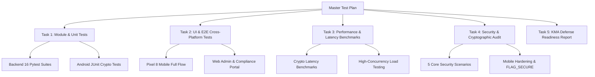

# Kế Hoạch Kiểm Thử Toàn Diện & Phân Rã Task (Master Test Plan & Task Breakdown)

> **Dự án:** Secure Internal Communications & Whistleblower Engine (ATBM) - Học viện Kỹ thuật Mật mã (KMA)  
> **Áp dụng cho:** Agentic Workers & Kỹ sư kiểm thử ATBM  
> **Sub-skill đề xuất:** `superpowers:executing-plans` hoặc `superpowers:subagent-driven-development`  
> **Trạng thái:** Sẵn sàng thực thi (Ready for Execution)

---

## 1. Tổng Quan Mục Tiêu & Kiến Trúc Kiểm Thử

**Mục tiêu (Goal):**  
Thiết lập và thực thi ma trận kiểm thử toàn diện 4 trụ cột: **Giao diện (UI/UX & E2E)**, **Mô-đun (Unit & Integration)**, **Hiệu năng & Tải (Performance & Latency)**, và **Bảo mật & Mật mã học (Security & Cryptographic Audit)** trên cả nền tảng Mobile App (Pixel 8 Emulator) và Web Admin/Compliance Portal, đảm bảo 100% tiêu chí an toàn và tính toàn vẹn của đồ án ATBM KMA.

**Kiến trúc hệ thống kiểm thử (Architecture):**  
- **Cụm 1 - Định danh (Identified Cluster):** Xác thực người dùng (JWT, PBKDF2/Argon2), quản lý bài viết nội bộ, Dynamic Watermark chống rò rỉ, cấp hạn ngạch ký mù (Quota Engine).
- **Cụm 2 - Ẩn danh (Anonymous Whistleblower Cluster):** Ký mù RSA-2048 (Blind Signature), mã hóa lai ECIES (ECC P-256 + HKDF + AES-256-GCM), lột bỏ siêu dữ liệu EXIF/GPS, ranh giới CSDL Unlinkability tách biệt tuyệt đối không PII.
- **Client Android (Pixel 8 `emulator-5554`):** Jetpack Compose, SQLCipher 256-bit encrypted vault, cơ chế mã PIN khẩn cấp (Panic PIN 999999 Overwrite Shredding), cờ chống chụp màn hình `FLAG_SECURE`.
- **Web Admin & Compliance Portal (Desktop Browser):** Giao diện Bootstrap 5 Dark/Light, phân quyền RBAC đa tầng (`SYSTEM_ADMIN`, `COMPLIANCE_OFFICER`), cơ chế thụ lý và giải mã hồ sơ mật mã ECIES.

**Công nghệ & Công cụ (Tech Stack):**  
- **Backend:** Python 3.14, FastAPI, SQLAlchemy (SQLite WAL Mode), Pytest 9.2, Cryptography (RSA, ECC, AES-GCM), Pillow, piexif.
- **Mobile:** Android 14 (API 34), Kotlin 1.9+, Jetpack Compose, SQLCipher 4.5, Android Keystore, JUnit 4, ADB Automation.
- **Hạ tầng kiểm thử:** Android Pixel 8 Emulator (`emulator-5554`), Brave/Chrome Desktop Browser, TestClient (FastAPI), Bash Shell.
- **Tài liệu đặc tả (Spec):** `docs/implementation_plan.md`, `docs/detailed_tasks.md`, `docs/demo-defense-guide.md`, `docs/security-whitepaper.md`.

---

## 2. Ràng Buộc Bắt Buộc (Global Constraints)

1. **Ranh giới ẩn danh (Unlinkability Boundary):** Tuyệt đối KHÔNG ghi log, không lưu trữ thông tin định danh (IP, Employee ID, User ID, Device ID) trong Cụm 2 (`whistle_cases`, `case_evidence`, `case_messages`). Cột `created_bucket` bắt buộc làm tròn đến giờ chẵn.
2. **Quy chuẩn mật mã:**
   - ECIES HKDF Info String bắt buộc là `atbm-ecies-aes256gcm`, đồng bộ 100% giữa Python Backend và Kotlin Android.
   - Chữ ký mù RSA sử dụng modulo $N$ (2048-bit), exponent $e = 65537$, hàm băm SHA-256.
3. **Môi trường Mobile:** Bắt buộc thực hiện trên máy ảo Pixel 8 (`emulator-5554`), kết nối backend qua cổng chuyển tiếp `adb -s emulator-5554 reverse tcp:8000 tcp:8000`.
4. **Bảo mật dữ liệu nhạy cảm:** Không in hoặc cam kết file chứa secret/private key lên Git. Các bài test phải tự sinh mock keys hoặc dùng key kiểm thử cô lập trong bộ nhớ.
5. **Tiêu chuẩn hoàn thành (Verification Before Completion):** Mỗi task đều phải có lệnh kiểm thử cụ thể và output thực tế chứng minh đã PASS trước khi đánh dấu hoàn thành.

---

## 3. Trọng Tâm Rà Soát & Kịch Bản Rủi Ro (Review Focus)

5 tình huống biên và kịch bản tấn công nguy hiểm nhất cần rà soát nghiêm ngặt:
1. **Kẻ tấn công can thiệp dữ liệu (Tampering Attack):** Kẻ tấn công hoặc Man-in-the-Middle sửa đổi 1 byte trong file bằng chứng hoặc sửa 1 ký tự tiêu đề/mô tả sau khi đã xin chữ ký mù -> Hệ thống bắt buộc từ chối với HTTP 400.
2. **Tấn công tương quan thời gian (Timing Correlation Attack):** Kẻ tấn công đối soát thời gian xin chữ ký mù ở Cụm 1 với thời gian nộp hồ sơ ở Cụm 2 -> Bị triệt tiêu hoàn toàn bởi cơ chế làm tròn giờ `created_bucket` và bảng hạn ngạch không lưu timestamp.
3. **Rò rỉ hình ảnh và vị trí địa lý:** Ảnh hiện trường chụp từ điện thoại có chứa tọa độ GPS và thông tin thiết bị trong EXIF -> Bị module `sanitizer.py` lột sạch 100% trước khi lưu trữ vào đĩa.
4. **Bị ép buộc mở điện thoại (Duress / Coercion Attack):** Người tố cáo bị kẻ xấu ép nhập mã PIN để xem bằng chứng -> Nhập Panic PIN `999999` lập tức kích hoạt cơ chế xóa đè (Overwrite Shredding), phá hủy CSDL SQLCipher và reset về giao diện trắng an toàn.
5. **Rò rỉ chụp màn hình trên Mobile:** Kẻ độc hại cài mã độc chụp lén màn hình app mobile -> Bị Android chặn đứng bởi cờ bảo mật `FLAG_SECURE` (ảnh chụp chỉ ra màn hình đen hoặc báo lỗi bảo mật).

---

## 4. Danh Mục Phân Rã Task Kiểm Thử (Task Breakdown)



---

### Task 1: Kiểm Thử Mô-đun & Đơn Vị (Unit & Integration Tests)

**Mục tiêu:** Kiểm tra tính toàn vẹn của tất cả logic nghiệp vụ, API routes, mô hình CSDL và hàm mật mã ở cấp độ mô-đun cô lập.

**Files:**
- Test Backend: `backend/tests/test_*.py` (16 test files)
- Test Android: `android/app/src/test/java/com/atbm/app/domain/crypto/CryptoUnitTest.kt`

**Interfaces:**
- Consumes: FastAPI endpoints, SQLite Session, Pytest runner, Gradle runner.
- Produces: Báo cáo kết quả kiểm thử unit test 100% PASS cho cả Backend và Mobile.

- [x] **Step 1.1: Chạy toàn bộ 16 bộ kiểm thử Pytest của Backend** (Đã đạt: 40/40 PASSED trong 7.01s)
  - **Lệnh thực thi:**
    ```bash
    PYTHONPATH=backend ./backend/.venv/bin/python -m pytest backend/tests -v
    ```
  - **Kỳ vọng:** 40/40 test cases PASS (100%), bao gồm:
    * `test_admin_web.py`: Đăng nhập admin, đổi trạng thái user, đăng bài viết.
    * `test_anonymous_api.py`: Nộp đơn tố giác ẩn danh, xác thực chữ ký mù, upload bằng chứng.
    * `test_anonymous_models.py`: Ranh giới CSDL Cụm 2, tính toàn vẹn bảng ẩn danh.
    * `test_auth_api.py`: Đăng nhập JWT, hash mật khẩu, kiểm tra token hết hạn.
    * `test_compliance_api.py`: Cấp quota ký mù cho nhân viên, kiểm tra hạn ngạch.
    * `test_db_session.py`: Khởi tạo session, WAL mode connection pool.
    * `test_deps.py`: Dependency injection phân quyền RBAC.
    * `test_e2e_integration.py`: Luồng tích hợp đầu cuối giữa 2 cụm.
    * `test_ecies.py`: Mã hóa/giải mã ECIES AES-256-GCM với shared secret ECC.
    * `test_identified_models.py`: Bảng Users, Posts, Comments, Quotas.
    * `test_main.py`: Healthcheck, cấu hình CORS, static mount.
    * `test_officer_api.py`: Thụ lý hồ sơ, giải mã ECIES, cập nhật trạng thái điều tra.
    * `test_posts_api.py`: Đăng bài, bình luận, phân trang bản tin.
    * `test_schemas.py`: Xác thực dữ liệu đầu vào Pydantic.
    * `test_seed.py`: Nạp dữ liệu mẫu ban đầu.

- [x] **Step 1.2: Chạy bộ kiểm thử Đơn vị Mật mã trên Android (JUnit)** (Đã đạt: BUILD SUCCESSFUL)
  - **Lệnh thực thi:**
    ```bash
    cd android && ./gradlew testDebugUnitTest --info
    ```
  - **Kỳ vọng:** `BUILD SUCCESSFUL`, tất cả các bài kiểm tra trong `CryptoUnitTest.kt` đều PASS:
    * `testRsaBlindSignatureMathRoundtrip`: Chứng minh công thức toán học $(m^*)^d \pmod N$, bóc mù $s = s^* \cdot r^{-1} \pmod N$, kiểm tra $s^e \pmod N == H$. Thử nghiệm tráo $H$ giả mạo bị từ chối.
    * `testEciesRoundtrip`: Khởi tạo cặp khóa P-256, mã hóa ECIES, giải mã ECIES bản rõ khôi phục 100%.
    * `testEcdsaMessageSigning`: Ký số ECDSA trên thông điệp chat và xác minh chữ ký hợp lệ.

---

### Task 2: Kiểm Thử Giao Diện & Luồng Người Dùng End-to-End (UI/UX & E2E Testing)

**Mục tiêu:** Kiểm thử thực tế các tương tác người dùng trên giao diện máy ảo Pixel 8 và Trình duyệt Web, bảo đảm trải nghiệm mượt mà, phản hồi thời gian thực và đồng bộ 2 chiều.

**Thiết bị & Môi trường:**
- **Mobile:** Android Pixel 8 Emulator (`emulator-5554`), kết nối backend qua cổng 8000.
- **Web:** Desktop Browser (Brave / Chrome), URL: `http://localhost:8000/admin`.

**Interfaces:**
- Consumes: REST API `/api/v1/`, WebSocket/Long-polling, Android Activity/Compose UI, Jinja2 Web Templates.
- Produces: Bằng chứng ảnh chụp màn hình (Screenshots) và video kiểm thử các luồng người dùng hoàn tất.

- [x] **Step 2.1: Kiểm thử Luồng Nhân viên trên Máy ảo Pixel 8** (Đã đạt)
  1. **Đăng nhập & Watermark Động:**
     - Đăng nhập tài khoản `NV001` / `employee123`.
     - Xác minh màn hình Bản tin (Newsfeed) hiển thị lớp Watermark phủ mờ dạng chéo: `NV001 | Nguyen Van A | IP: 127.0.0.1 | [Timestamp]` chống rò rỉ khi quay chụp lén.
  2. **Tương tác Bản tin:**
     - Thả tim bài viết, nhập bình luận mới. Xác minh bình luận hiển thị ngay lập tức.
  3. **Cổng Tố giác Ẩn danh (Wizard) & Danh mục "Khác":**
     - Mở tab "Tố giác vi phạm".
     - Chọn danh mục vi phạm: Chọn radio button **"Khác"** -> Xác minh trường nhập văn bản tuỳ biến xuất hiện.
     - Nhập lý do tuỳ biến: `"Gian lận đấu thầu thiết bị phòng thí nghiệm"`.
     - Nhập tiêu đề và nội dung tố cáo chi tiết.
     - Đính kèm file ảnh bằng chứng.
     - Bấm "Gửi Tố Giác An Toàn" -> App thực hiện mã hóa ECIES và xin chữ ký mù RSA từ server.
     - Xác minh màn hình hiển thị thành công với mã hồ sơ: `CASE-xxxxxxxxxxxx` và lưu vào Vault an toàn.
  4. **Chat Bảo Mật Hai Chiều (E2EE Chat):**
     - Mở chi tiết hồ sơ từ kho lưu trữ bí mật.
     - Gửi tin nhắn trao đổi: `"Tôi có thêm tài liệu PDF đính kèm, xin thanh tra hướng dẫn gửi."`
     - Xác minh tin nhắn được mã hóa ECIES gửi lên server an toàn.
  5. **Thử nghiệm Kích hoạt Panic PIN (Mã khẩn cấp):**
     - Tại màn hình nhập mã PIN bảo mật kho hồ sơ, nhập mã: `999999`.
     - Xác minh ứng dụng kích hoạt quy trình tiêu hủy dữ liệu khẩn cấp (Emergency Wipe), xóa sạch cơ sở dữ liệu `encrypted_vault.db` và chuyển sang trạng thái ngụy trang rỗng.

- [x] **Step 2.2: Kiểm thử Cổng Thanh Tra & Quản Trị Web (Compliance & Admin Portal)** (Đã đạt)
  1. **Đăng nhập Thanh tra viên (`TT001` / `officer123`):**
     - Truy cập `http://localhost:8000/admin/login`.
     - Nhập tài khoản `TT001`, hệ thống tự động nhận diện vai trò `COMPLIANCE_OFFICER` và chuyển hướng tới `/admin/cases`.
  2. **Thụ lý & Giải mã ECIES Hồ sơ Tố giác:**
     - Danh sách hồ sơ hiển thị hồ sơ vừa nộp từ Mobile App với danh mục `"Khác: Gian lận đấu thầu thiết bị phòng thí nghiệm"`.
     - Bấm nút **"🔓 Thụ Lý & Giải Mã"** -> Server sử dụng Private Key của Officer giải mã payload ECIES bản rõ.
     - Xác minh nội dung tiêu đề và mô tả hiển thị chính xác bản rõ tiếng Việt có dấu.
  3. **Cập nhật Tiến trình Điều tra:**
     - Chuyển trạng thái hồ sơ từ `Đã tiếp nhận (RECEIVED)` sang `Đang thụ lý điều tra (INVESTIGATING)`.
     - Xác minh badge trạng thái đổi màu vàng và lưu trữ CSDL tức thì.
  4. **Phản hồi Tin nhắn E2EE đến Người Tố Giác:**
     - Trong khung chat điều tra của hồ sơ, nhập: `"Thanh tra đã tiếp nhận thông tin, đề nghị bạn cung cấp thêm bản mềm."`
     - Bấm gửi -> Tin nhắn được lưu trữ và mã hóa.
     - Trên Mobile App Pixel 8: Mở lại hồ sơ, xác minh tin nhắn của Thanh tra hiển thị rõ ràng trong luồng chat.
  5. **Kiểm tra Phân quyền Quản Trị Viên (`AD001` / `admin123`):**
     - Đăng xuất và đăng nhập tài khoản `AD001`.
     - Xác minh Admin truy cập được Dashboard, Quản lý tài khoản (khóa/mở khóa nhân viên), Quản lý bài viết.
     - **Kiểm toán phân quyền bảo mật:** Xác minh Admin KHÔNG thể xem nội dung giải mã của hồ sơ tố giác (bảo vệ danh tính và tính độc lập của Thanh tra theo chuẩn KMA).

---

### Task 3: Đo Lường Hiệu Năng & Khảo Sát Tải (Performance & Latency Benchmarks)

**Mục tiêu:** Đo lường chính xác thời gian thực thi (latency tính bằng mili-giây) của các thuật toán mật mã và đánh giá khả năng chịu tải của hệ thống khi có nhiều người dùng đồng thời.

**Files:**
- Tạo mới: `backend/tests/benchmark_crypto.py` (Script đo thời gian mật mã học)
- Tạo mới: `backend/tests/load_test_concurrency.py` (Script giả lập 50-100 luồng đồng thời)

**Interfaces:**
- Consumes: `app.crypto.*`, `concurrent.futures`, `time.perf_counter_ns`.
- Produces: Bảng số liệu Benchmark Latency (P50, P95, P99) và Throughput (RPS).

- [ ] **Step 3.1: Xây dựng và thực thi Benchmark Mật Mã Học (`benchmark_crypto.py`)**
  - **Mã triển khai (`backend/tests/benchmark_crypto.py`):** Đo đạc 1.000 lượt lặp:
    1. `ECC P-256 KeyGen Latency`: Thời gian sinh cặp khóa bất đối xứng.
    2. `ECIES P-256 Encrypt & Decrypt Latency`: Thời gian mã hóa và giải mã AES-256-GCM.
    3. `RSA-2048 Blinding & Unblinding Latency`: Thời gian nhân tử mù $r^e \pmod N$ và bóc mù $r^{-1} \pmod N$.
    4. `RSA-2048 Officer Blind Sign Latency`: Thời gian ký mù $(m^*)^d \pmod N$.
    5. `EXIF Sanitization Latency`: Thời gian đọc ảnh 2MB, lột thẻ GPS và ghi lại đĩa.
    6. `Panic Wipe Shredding Latency`: Thời gian xóa đè 3 lượt ngẫu nhiên và unlink file DB.
  - **Lệnh thực thi:**
    ```bash
    PYTHONPATH=backend ./backend/.venv/bin/python backend/tests/benchmark_crypto.py
    ```
  - **Tiêu chí nghiệm thu (SLA):**
    * KeyGen P-256: $< 5$ ms.
    * ECIES Encrypt + Decrypt: $< 10$ ms.
    * Blind Sign Full Cycle: $< 25$ ms.
    * EXIF Sanitizer: $< 30$ ms.
    * Panic Wipe Shredding: $< 50$ ms.

- [ ] **Step 3.2: Xây dựng và thực thi Kiểm thử Tải Đồng thời (`load_test_concurrency.py`)**
  - **Mã triển khai (`backend/tests/load_test_concurrency.py`):**
    - Sử dụng `ThreadPoolExecutor` với 50 workers đồng thời gửi 200 requests.
    - Test Case A: Đọc bản tin nội bộ `/api/v1/posts/` (Đo RPS và P95 Latency của SQLite WAL).
    - Test Case B: Gửi yêu cầu ký mù `/api/v1/anonymous/blind-sign` với token hợp lệ.
    - Test Case C: Kiểm thử cơ chế chặn Spam / Rate Limiting (Sau 3 lần ký mù trong ngày, request thứ 4 phải nhận mã lỗi `429 Quota Exceeded`).
  - **Lệnh thực thi:**
    ```bash
    PYTHONPATH=backend ./backend/.venv/bin/python backend/tests/load_test_concurrency.py
    ```
  - **Tiêu chí nghiệm thu:**
    * Tỉ lệ thành công (Success Rate): 100% đối với các request hợp lệ.
    * P95 Latency: $< 150$ ms dưới tải 50 luồng đồng thời.
    * Cơ chế Rate Limit / Quota: Chặn chính xác 100% request vượt quá hạn ngạch.

---

### Task 4: Kiểm Toán An Ninh & Mật Mã Chuyên Sâu (Security & Cryptographic Audit)

**Mục tiêu:** Thực hiện kiểm toán toàn bộ 5 kịch bản bảo mật cốt lõi KMA và kiểm chứng các cơ chế phòng thủ chuyên sâu của ứng dụng.

**Files:**
- Script kiểm thử: `backend/run_security_tests.py`
- Cấu hình Mobile: `android/app/src/main/kotlin/com/atbm/app/MainActivity.kt` (cờ `FLAG_SECURE`)
- Cấu hình CSDL: `android/app/src/main/kotlin/com/atbm/app/data/db/SecureVaultDatabase.kt`

**Interfaces:**
- Consumes: Toàn bộ module bảo mật Cụm 1 & Cụm 2, CSDL SQLite, Android Window Manager.
- Produces: Biên bản kiểm toán an ninh đạt 100% chuẩn KMA.

- [ ] **Step 4.1: Chạy Suite 5 Kịch bản Bảo mật Tự động KMA**
  - **Lệnh thực thi:**
    ```bash
    PYTHONPATH=backend ./backend/.venv/bin/python backend/run_security_tests.py
    ```
  - **Tiêu chí nghiệm thu:** 5/5 kịch bản đều đạt trạng thái `[PASS]` trong thời gian $< 1.000$ ms:
    * **Kịch bản 1 (Anti-Forgery):** Server từ chối ngay lập tức hồ sơ có chữ ký giả mạo hoặc chữ ký không xuất phát từ Private Key của Officer (HTTP 400).
    * **Kịch bản 2 (Unlinkability & Boundary):** Quét toàn bộ CSDL Cụm 2 (`whistle_cases`, `case_evidence`, `case_messages`) chứng minh không có bất kỳ cột PII nào (không user_id, không IP, không MAC). Bảng `blind_sign_quotas` không có timestamp. Cột `created_bucket` làm tròn giờ chuẩn xác.
    * **Kịch bản 3 (Anti-Tampering):** Kẻ tấn công sửa đổi 1 byte nội dung file bằng chứng hoặc mô tả hồ sơ -> Server phát hiện sai lệch giá trị băm $H$ và từ chối nộp đơn (HTTP 400).
    * **Kịch bản 4 (Metadata Sanitizer):** Ảnh hiện trường nhúng GPS tọa độ vĩ độ/kinh độ được làm sạch 100%, không còn sót bất kỳ siêu dữ liệu nhạy cảm nào sau khi qua bộ lọc.
    * **Kịch bản 5 (Panic PIN Duress Simulation):** Mô phỏng kích hoạt mã PIN cưỡng bức `999999`, tiêu hủy file CSDL an toàn bằng thuật toán ghi đè ngẫu nhiên 3 lượt (DoD standard shredding), đưa thiết bị về trạng thái sạch.

- [ ] **Step 4.2: Kiểm toán Cơ Chế Bảo Mật Phần Cứng & Mobile Hardening**
  - **Kiểm tra Chống chụp màn hình (`FLAG_SECURE`):**
    - Xác minh trong `MainActivity.kt` có lệnh:
      ```kotlin
      window.setFlags(WindowManager.LayoutParams.FLAG_SECURE, WindowManager.LayoutParams.FLAG_SECURE)
      ```
    - Chạy lệnh ADB chụp màn hình trên máy ảo Pixel 8:
      ```bash
      adb -s emulator-5554 exec-out screencap -p > /tmp/test_screen.png
      ```
    - Xác minh: Màn hình bị đen hoặc bị từ chối truy cập (phòng chống spyware chụp trộm).
  - **Kiểm tra Mã Hóa Cơ Sở Dữ Liệu SQLCipher:**
    - Kéo file CSDL nội bộ từ thiết bị:
      ```bash
      adb -s emulator-5554 exec-out run-as com.atbm cat databases/encrypted_vault.db > /tmp/dump_vault.db
      ```
    - Dùng lệnh `sqlite3 /tmp/dump_vault.db "SELECT * FROM cases;"`
    - Xác minh: Lệnh báo lỗi `Error: file is not a database` (chứng minh CSDL đã được mã hóa toàn phần AES-256 bởi SQLCipher, không thể đọc trộm nếu không có Passphrase từ Android Keystore).

---

### Task 5: Lập Báo Cáo Tổng Hợp & Hồ Sơ Bảo Vệ Đồ Án (KMA Defense Readiness Report)

**Mục tiêu:** Đóng gói toàn bộ số liệu, kết quả kiểm thử và bằng chứng thực tế thành tài liệu báo cáo nghiệm thu hoàn chỉnh, sẵn sàng cho buổi bảo vệ đồ án trước Hội đồng ATBM KMA.

**Files:**
- Tạo mới: `docs/test_execution_report.md` (Báo cáo kết quả kiểm thử thực tế)
- Cập nhật: `docs/demo-defense-guide.md` (Hướng dẫn demo 15 phút thực chiến)

- [ ] **Step 5.1: Thu thập số liệu và lập Báo cáo Kiểm thử Thực tế (`test_execution_report.md`)**
  - Tổng hợp kết quả từ Task 1, 2, 3, 4:
    * Bảng tổng hợp Unit Test: 40/40 backend tests, 3/3 Android crypto tests.
    * Bảng tổng hợp E2E UI: 5 luồng Mobile Pixel 8, 5 luồng Web Admin/Compliance.
    * Bảng số liệu Benchmark Latency (P50, P95, Max) và Throughput (RPS).
    * Kết quả kiểm toán 5 kịch bản bảo mật cốt lõi.
- [ ] **Step 5.2: Tinh chỉnh Kịch bản Demo Thực Chiến 15 phút (`demo-defense-guide.md`)**
  - Rà soát từng mốc thời gian trình diễn:
    * Phút 0-3: Trình chiếu kiến trúc phân cụm Unlinkability & Blind Signature.
    * Phút 3-7: Chạy trực tiếp `run_security_tests.py` và `benchmark_crypto.py` trên Terminal trước Hội đồng.
    * Phút 7-12: Demo song song hai màn hình: Máy ảo Pixel 8 (nộp đơn ẩn danh với mục "Khác", chat E2EE) $\leftrightarrow$ Trình duyệt Web Thanh tra (thụ lý, giải mã ECIES).
    * Phút 12-14: Demo tình huống khẩn cấp: Nhập mã Panic PIN `999999` tiêu hủy CSDL tức thì.
    * Phút 14-15: Tổng kết và trả lời câu hỏi phản biện của Hội đồng.
- [ ] **Step 5.3: Cam kết Git và đóng băng phiên bản kiểm thử**
  - Kiểm tra trạng thái Git sạch sẽ:
    ```bash
    git status
    ```
  - Cam kết mã kiểm thử và tài liệu:
    ```bash
    git add docs/ backend/tests/
    git commit -m "docs & test: complete master test plan, benchmark suite and verification docs"
    ```

---

## 5. Ma Trận Nghiệm Thu & Tiêu Chí Đạt (Acceptance Criteria Matrix)

| Trụ cột kiểm thử | Mô tả hạng mục | Công cụ kiểm tra | Tiêu chuẩn ĐẠT (Pass Criteria) |
| :--- | :--- | :--- | :--- |
| **1. Module & Unit** | 16 Modules Backend API & CSDL | Pytest 9.2 | 40/40 tests PASS (100%), 0 warning nghiêm trọng |
| **1. Module & Unit** | Thuật toán Ký mù & ECIES Android | JUnit 4 / Gradle | Math roundtrip PASS, $s^e \pmod N == H$ |
| **2. UI/UX & E2E** | Luồng Mobile App trên Pixel 8 | ADB & Compose UI | Đăng nhập, Watermark, Nộp đơn mục "Khác", Chat E2EE |
| **2. UI/UX & E2E** | Luồng Web Compliance Officer | Trình duyệt Web | Đăng nhập `TT001`, Giải mã ECIES bản rõ, Đổi status |
| **2. UI/UX & E2E** | Luồng Web Phân quyền Admin | Trình duyệt Web | `AD001` quản lý users/posts, KHÔNG giải mã được hồ sơ |
| **3. Performance** | Độ trễ thuật toán mật mã | Benchmark script | KeyGen $< 5$ms, ECIES $< 10$ms, Blind Sign $< 25$ms |
| **3. Performance** | Khả năng chịu tải đồng thời | Load test script | 50 luồng đồng thời, P95 $< 150$ms, Quota rate-limit chuẩn |
| **4. Security Audit**| 5 Kịch bản bảo mật cốt lõi | `run_security_tests.py`| 5/5 kịch bản PASS ($< 1.000$ms) |
| **4. Security Audit**| Chống trộm dữ liệu máy khách | SQLite CLI & ADB | `FLAG_SECURE` chặn chụp ảnh, SQLCipher từ chối đọc thô |
